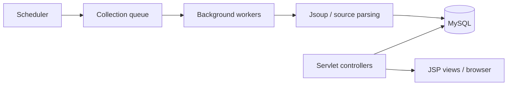

# News Aggregator — Java News Collection Web App

> Java web application for collecting, organizing, and browsing news from multiple sources.

**Reported stack:** Java · Servlet/JSP · MySQL · Jsoup · MVC · background workers / scheduling

## Overview

News Aggregator explores a server-side workflow for fetching articles, storing metadata, and presenting content through a topic-oriented web application. The project emphasizes backend processing and separation between web requests and background collection work.

## Project functionality

- Collect articles from configured news sources using HTML parsing.
- Store and retrieve news metadata in MySQL.
- Organize articles by topic and display results through JSP/Servlet pages.
- Use scheduled collection and worker/queue-based processing as described in the project materials.
- Provide a browser interface for exploring collected content.

## Architecture (conceptual)

This diagram summarizes the described design; verify exact class names, queue mechanics, and persistence mappings against the current source.

## Running locally

1. Install the JDK and MySQL versions required by the checked-out project.
2. Inspect the repository for its build tool (`pom.xml` or another build file), SQL schema and application configuration.
3. Create a local MySQL database and configure credentials **outside version control**.
4. Start the application using the server/container required by its actual Servlet/JSP configuration.
5. Configure sources and run the documented collection job, then verify article results in the UI.

> The exact build command, servlet container, SQL file and package names have not been independently verified for this draft. Replace these steps with tested commands from the repository before publishing them as a guaranteed quick start.

## Improvements to consider

- Add screenshots of the article listing, filters and background job status.
- Document source configuration and crawling frequency.
- Add automated tests for parsing changes and database persistence.
- Respect source-site robots policies and terms; avoid republishing copyrighted full article content.

## Project context

Academic Java web/backend project. This README is based on previously described repository functionality; a fresh full-source audit was not available when this draft was created.
